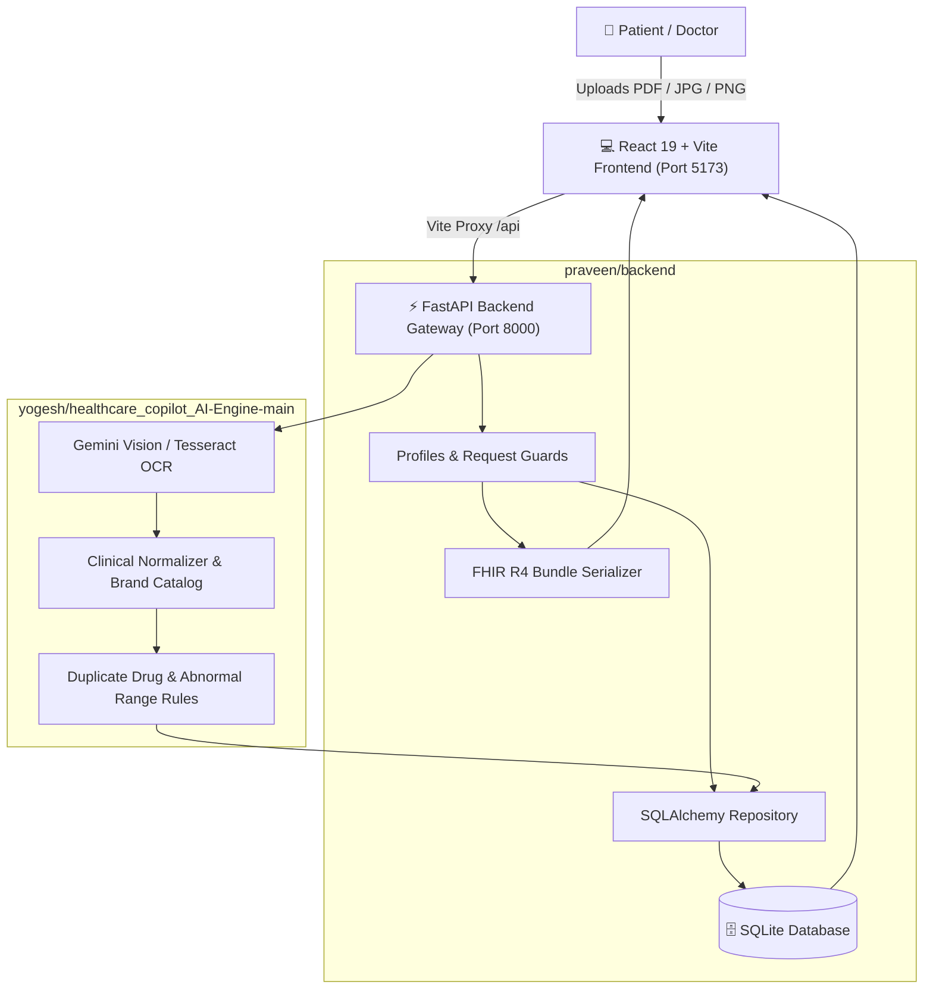

# 🏥 AarogyaAI — Multilingual AI Health Records Copilot
> **Intelligent Clinical Document Decoding, ABDM FHIR R4 Standardization, and Multilingual Patient Health Navigation**

<div align="center">

[](#)
[](#)
[](#)
[](#)
[](#)
[](#)
[](#)
[](#)

<br/>

[](#)
[](#)
[](#)
[](#)
[](#)

</div>

---

## 📖 Overview

**AarogyaAI** is an open, standards-compliant Clinical Health Records Copilot built to empower Indian patients and families. It converts messy, handwritten doctor prescriptions, pathology lab reports, and complex discharge summaries into clear, structured, and clinically validated health timelines.

Patients can interact with their health data in **English**, **தமிழ் (Tamil)**, or **हिन्दी (Hindi)** with voice read-aloud capabilities, ask plain-language questions grounded strictly in their own medical records, detect duplicate brand medications, track longitudinal biomarkers (e.g. HbA1c trends), and generate ABDM-ready **FHIR R4 JSON bundles**.

---

## ✨ Key Features & Capabilities

| Feature | Icon | Description |
| :--- | :---: | :--- |
| **Clinical OCR & Vision AI** | 📄 | Decodes lab reports, handwritten prescriptions, and discharge summaries with bounding-box confidence verification. |
| **Multilingual Explanations** | 🌐 | Instant medical translations in **English**, **தமிழ் (Tamil)**, and **हिन्दी (Hindi)** with native text-to-speech synthesis. |
| **Duplicate Drug Alerts** | ⚠️ | Automatically flags dangerous duplicate active ingredients (e.g. *Glucophage* + *Obimet SR* both containing Metformin). |
| **Biomarker Trends** | 📈 | Longitudinal interactive graphs tracking vital lab measurements (e.g. HbA1c reduction from 9.2% to 6.8%). |
| **Doctor Visit Prep** | 🩺 | Synthesizes active diagnoses, current medication regimens, and patient questions into a 1-page clinical brief. |
| **Emergency Medical Card** | 🚨 | One-tap offline-ready medical passport showing blood type, emergency contacts, critical conditions, and active drugs. |
| **Ask Your Records AI** | 💬 | Plain-language Q&A grounded strictly in patient files with citation source chips (no medical hallucinations). |
| **ABDM / ABHA Sandbox** | 🇮🇳 | 14-digit ABHA ID linking simulation with ABDM Gateway FHIR bundle record ingestion. |
| **FHIR R4 Standard Export** | 🏥 | One-click export of hospital encounters, observations, and medication statements in standardized FHIR R4 JSON. |

---

## 🏗️ System Architecture



---

## 👥 Engineering Team & Modules

| Contributor | Engineering Subsystem | Core Responsibilities & Technologies | Folder Path |
| :--- | :--- | :--- | :--- |
| **Praveen** | **Backend Core & Database** | • FastAPI REST endpoints & lifecycle<br>• SQLite / SQLAlchemy data persistence<br>• FHIR R4 Bundle generation<br>• Multi-profile & ABHA sandbox mock | [`praveen/backend`](file:///c:/Users/Praveen/Desktop/final/praveen/backend) |
| **Yogesh** | **AI Extraction Engine** | • Gemini Vision & OCR document processing<br>• Indian drug brand-to-generic catalog<br>• Medical terminology normalization<br>• Drug conflict & alert evaluation engine | [`yogesh/healthcare_copilot_AI-Engine-main`](file:///c:/Users/Praveen/Desktop/final/yogesh/healthcare_copilot_AI-Engine-main) |
| **Naveen** | **Frontend UI & Hospital Portal** | • React 19 + TypeScript modern SPA<br>• Multilingual i18n (EN / TA / HI)<br>• Recharts trend visualization<br>• Responsive Tailwind CSS clinical theme | [`naveen/hi-main/hi-main/frontend`](file:///c:/Users/Praveen/Desktop/final/naveen/hi-main/hi-main/frontend) |

---

## 📁 Repository Directory Structure

```text
├── praveen/
│   └── backend/                     # FastAPI core, DB models, routers, services, SQLite
│       ├── app/                     # Routers (records, profiles, fhir, ask, abha)
│       ├── scripts/                 # Demo database seeding script
│       ├── tests/                   # Pytest suite (84 automated tests)
│       └── uploads/                 # Secure document storage
├── yogesh/
│   └── healthcare_copilot_AI-Engine-main/  # OCR, LLM extraction & clinical catalog
│       ├── ai_engine/               # Gemini Vision extractor, normalizer, catalogs
│       ├── samples/                 # Sample prescriptions and ground truths
│       └── tests/                   # Pytest suite (167 automated tests)
├── naveen/
│   └── hi-main/hi-main/
│       ├── frontend/                # React 19 + TypeScript SPA
│       │   ├── src/                 # Screens, components, API client, i18n
│       │   ├── tests/               # Frontend client tests (12 tests)
│       │   ├── Dockerfile           # Multi-stage production container
│       │   └── nginx.conf           # Production Nginx reverse-proxy
│       └── docs/                    # UI specifications & presentation notes
├── qa/                              # Quality assurance & audit runner scripts
├── docker-compose.yml               # Production multi-container orchestrator
├── Dockerfile.backend               # Container definition for FastAPI backend
├── render.yaml                      # Cloud deployment blueprint (Render)
├── start_all.bat                    # One-click Windows runner (Backend + Frontend)
├── requirements.txt                 # Unified Python dependencies
└── README.md                        # Master Project Documentation
```

---

## 🚀 Quick Start (Local Run)

### Method 1: One-Click Windows Launcher (Recommended)
Double-click the root batch script:
```bat
start_all.bat
```
This automatically boots:
- **Backend API:** `http://127.0.0.1:8000` (FastAPI + Swagger Docs at `/docs`)
- **Frontend Portal:** `http://127.0.0.1:5173` (React 19 with `/api` proxy)

---

### Method 2: Manual Terminal Execution

#### 1. Backend Setup
```powershell
# Navigate to praveen/backend and run with project virtual environment
.\.venv\Scripts\python.exe -m uvicorn app.main:app --host 127.0.0.1 --port 8000
```

#### 2. Frontend Setup
```powershell
# Navigate to frontend directory
cd naveen/hi-main/hi-main/frontend
npm run dev -- --host 127.0.0.1 --port 5173
```

---

## 🐳 Production Deployment

### Option A: Docker Compose (One-Command Deployment)
Run the entire production stack inside isolated containers:
```bash
docker compose up --build -d
```
- **Web App:** `http://localhost:5173`
- **Backend API:** `http://localhost:8000`
- **Swagger Docs:** `http://localhost:8000/docs`

### Option B: Cloud Deployment (Render / Railway / AWS)
This repository includes a native [`render.yaml`](file:///c:/Users/Praveen/Desktop/final/render.yaml) specification:
- **Web API Service:**
  - Build Command: `pip install -r requirements.txt`
  - Start Command: `uvicorn praveen.backend.app.main:app --host 0.0.0.0 --port $PORT`
  - Environment: `USE_MOCK_AI=true` (or provide `GEMINI_API_KEY`)
- **Static Frontend:**
  - Root: `naveen/hi-main/hi-main/frontend`
  - Build Command: `npm install && npm run build`
  - Publish Directory: `dist`

---

## 📡 Core API Endpoints

| Method | Endpoint | Description |
| :---: | :--- | :--- |
| `GET` | `/api/health` | System health, engine version, and active AI mode |
| `GET` | `/api/profiles` | List registered family and patient profiles |
| `GET` | `/api/profiles/{id}/timeline` | Chronological medical records timeline |
| `POST` | `/api/profiles/{id}/records` | Upload PDF/PNG clinical report for AI extraction |
| `GET` | `/api/records/{id}` | Retrieve parsed medicines, tests, and diagnoses |
| `PUT` | `/api/records/{id}` | Save user-confirmed edits to clinical data |
| `GET` | `/api/records/{id}/fhir` | Export record as ABDM-ready FHIR R4 Bundle |
| `GET` | `/api/profiles/{id}/trends?test=HbA1c` | Longitudinal trend data for specific lab tests |
| `GET` | `/api/profiles/{id}/alerts` | Active safety alerts (duplicate drugs, abnormal tests) |
| `POST` | `/api/profiles/{id}/ask` | Grounded Plain-Language AI Q&A over patient history |
| `POST` | `/api/profiles/{id}/abha/link` | [Mock] Link 14-digit ABHA ID to patient profile |

Interactive OpenAPI documentation is available at: **`http://127.0.0.1:8000/docs`**

---

## 🧪 Quality Assurance & Test Verification

All automated suites pass with **100% success rate**:

```bash
# 1. Backend Core Test Suite (84 Tests)
pytest praveen/backend/tests -q
# Result: 84 passed in 3.52s

# 2. AI Extraction Engine Test Suite (167 Tests)
pytest yogesh/healthcare_copilot_AI-Engine-main/tests -q
# Result: 167 passed in 1.55s

# 3. Frontend Client & Contract Suite (12 Tests)
cd naveen/hi-main/hi-main/frontend && npm test
# Result: 12 passed in 0.72s

# 4. Production TypeScript Compilation & Linter
cd naveen/hi-main/hi-main/frontend && npm run build
# Result: 0 Errors, 0 Warnings (Built in 2.24s)
```

---

## ⚖️ Clinical Disclaimer & Ethics

> **⚠️ Medical Disclaimer:**  
> AarogyaAI is an intelligent assistive technology designed to help patients understand and organize their personal health documents. It is **not** a diagnostic device and does **not** provide independent medical advice. Always consult a qualified registered medical practitioner or pharmacist for diagnosis, treatment, and medication decisions.